<!-- INÍCIO CABEÇALHO -->

  

##  about me

**UX-driven front-end developer.** I study UX to build interfaces that are clearer, more accessible and more consistent.

I break down existing interfaces, understand the logic behind them and translate them into code, fine-tuning responsive behavior, interactions and the overall user experience. I treat **accessibility as part of the process, not as an afterthought or rework**, and my goal is to apply that principle to every line of code, building experiences that reach as many people as possible.

<!-- FIM ABOUT (EN) -->

<!-- INÍCIO PROCESS (EN) -->

##  from interface to code

<!-- Animated image (plays once and stops). If "reduce motion" is enabled in the OS, it renders static -->

<!-- FIM PROCESS (EN) -->
